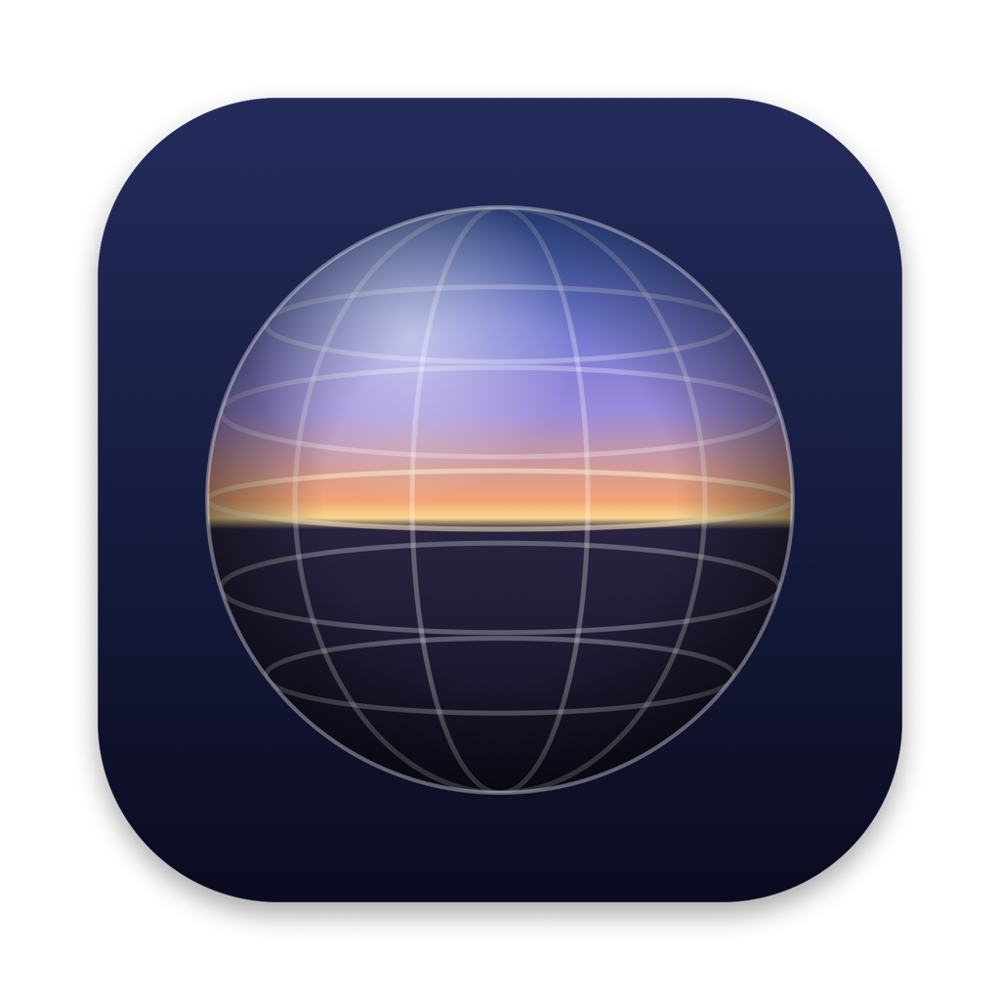

<p align="center"></p>

# Photosphere

A simple, pretty viewer for 360° photo spheres, for Mac, Windows and Linux.

Drop your panoramas on the window to add them, then drag to look around and scroll or pinch to zoom.

**On a MacBook with Apple silicon it gets better:** the screen becomes a window into the photo. Physically turn, tilt and lift the laptop to look around, and press harder on the trackpad to zoom. It reads the motion sensor, lid angle sensor and Force Touch trackpad built into the laptop.

## Download

Grab the latest build from [Releases](https://github.com/elibullockpapa/photosphere/releases/latest):

| Platform | File |
|---|---|
| Mac with Apple silicon | `Photosphere-…-mac-arm64.dmg` |
| Mac with Intel | `Photosphere-…-mac-x64.dmg` |
| Windows | `Photosphere-…-win-x64.exe` |
| Linux | `Photosphere-…-linux-x86_64.AppImage` |

**First launch on a Mac:** the app isn't notarized by Apple, so macOS blocks it the first time. Open it once, then go to **System Settings → Privacy & Security** and click **Open Anyway**. (Or run `xattr -dr com.apple.quarantine /Applications/Photosphere.app`.)

## Using it

| | |
|---|---|
| Add photos | Drop them on the window, the **+** button, or ⌘O. They're copied into the app's library. |
| Look around | Drag, or on a Mac, move the laptop |
| Zoom | Scroll, pinch, `+` / `-`, or on a Mac, press harder on the trackpad |
| Next / previous photo | `→` / `←`, or click a thumbnail |
| Recenter | `Space` |
| Control center | Click the pill at the bottom, or ⌘, |

### Direction locks (Mac motion)

| Lock | Key | What it does |
|---|---|---|
| **Turn** | `T` | Ignore turning the laptop left and right |
| **Tilt** | `U` | Keep the view at eye level |
| **Level** | `L` | Keep the horizon level when the laptop leans sideways (on by default) |
| **Freeze** | `F` | Hold the view still; drag to look around |

Everything lives in one control center that grows out of the pill at the bottom: your photos, the locks, and screens for **Zoom**, **View** and **Motion**.

**Pressure zoom** does nothing until you press past the *activation pressure*, so ordinary clicks never zoom. Past that point a small extra push takes you to full zoom; *sensitivity* sets how small. The Zoom screen has a live pressure meter showing both points.

360° photos are equirectangular images, twice as wide as they are tall. Most 360° cameras, Google Street View captures and phone panorama modes export them.

## Build it yourself

```bash
npm install
npm start          # run it
npm run dist       # package for the current platform into release/
```

Releases are built by GitHub Actions when a `v*` tag is pushed.

## How the Mac extras work

There's no public API for a MacBook's motion sensor. On Apple silicon MacBooks, an accelerometer and gyroscope sit behind the always-on processor and show up as HID devices (`AppleSPUHIDDevice`, vendor usage page `0xFF00`, usages 3 and 9), next to the lid angle sensor (usage page `0x20`, usage `0x8A`). A small helper (`native/`) wakes them up, fuses accelerometer and gyroscope readings into an orientation with a Mahony filter, reads Force Touch pressure from the private `MultitouchSupport` framework, and streams it all to the app. There's no compass, so the heading can slowly drift; `Space` recenters.

Credit to [olvvier/apple-silicon-accelerometer](https://github.com/olvvier/apple-silicon-accelerometer) and [Sam Henri Gold's lid angle sensor](https://github.com/samhenrigold/LidAngleSensor) for the reverse engineering. Sample photos are CC0 from [Poly Haven](https://polyhaven.com).
